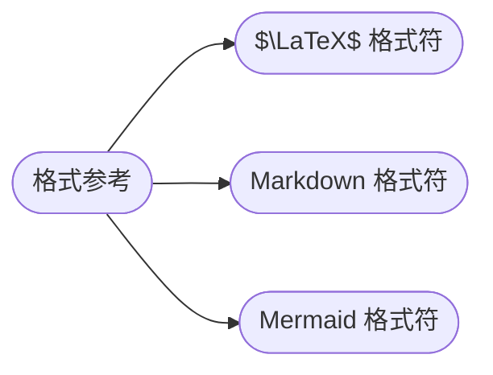

## 格式参考

[**返回上一页**](https://cuberxl.github.io/Coders-Note/)

[**返回首页**](https://cuberxl.github.io/Coders-Note/)

---

#### 格式参考

> 写笔记时用到的排版语法速查

| 编号 | 简介 |
| :--- | :--- |
| 0.1 | $\LaTeX$ 数学符号对照 |
| 0.2 | Markdown 语法速查 |
| 0.3 | Mermaid 图表语法速查 |

---

#### 章节结构

---

#### 跳转链接

- [0.1 $\LaTeX$ 格式符](https://cuberxl.github.io/Coders-Note/0-格式/LaTeX格式符)
- [0.2 Markdown 格式符](https://cuberxl.github.io/Coders-Note/0-格式/Markdown格式符)
- [0.3 Mermaid 格式符](https://cuberxl.github.io/Coders-Note/0-格式/Mermaid格式符)
