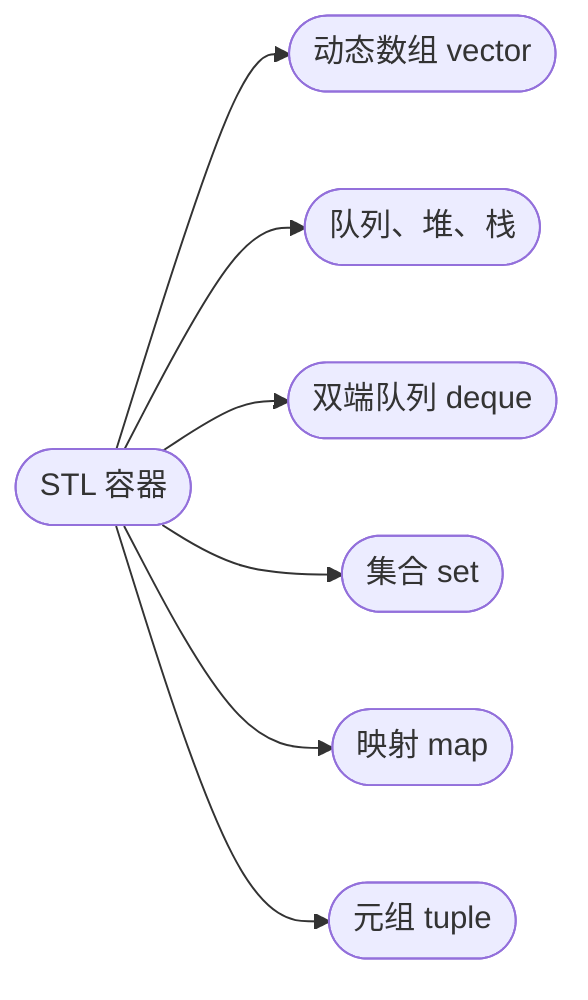

## STL 容器

[**返回上一页**](https://cuberxl.github.io/Coders-Note/1B-基本语法/)

[**返回首页**](https://cuberxl.github.io/Coders-Note/)

---

#### STL 容器

> 常用容器与操作

| 编号 | 简介 |
| :--- | :--- |
| 1B.9.1 | 动态数组 vector |
| 1B.9.2 | 队列、堆、栈 |
| 1B.9.3 | 双端队列 deque |
| 1B.9.4 | 集合 set |
| 1B.9.5 | 映射 map |
| 1B.9.6 | 元组 tuple |

---

#### 章节结构

---

#### 跳转链接

- [1B.9.1 动态数组 vector](https://cuberxl.github.io/Coders-Note/1B-基本语法/1.9-STL容器/1.9.1-动态数组vector)
- [1B.9.2 队列、堆、栈](https://cuberxl.github.io/Coders-Note/1B-基本语法/1.9-STL容器/1.9.2-队列、堆、栈)
- [1B.9.3 双端队列 deque](https://cuberxl.github.io/Coders-Note/1B-基本语法/1.9-STL容器/1.9.3-双端队列deque)
- [1B.9.4 集合 set](https://cuberxl.github.io/Coders-Note/1B-基本语法/1.9-STL容器/1.9.4-集合set)
- [1B.9.5 映射 map](https://cuberxl.github.io/Coders-Note/1B-基本语法/1.9-STL容器/1.9.5-映射map)
- [1B.9.6 元组 tuple](https://cuberxl.github.io/Coders-Note/1B-基本语法/1.9-STL容器/1.9.6-元组tuple)
