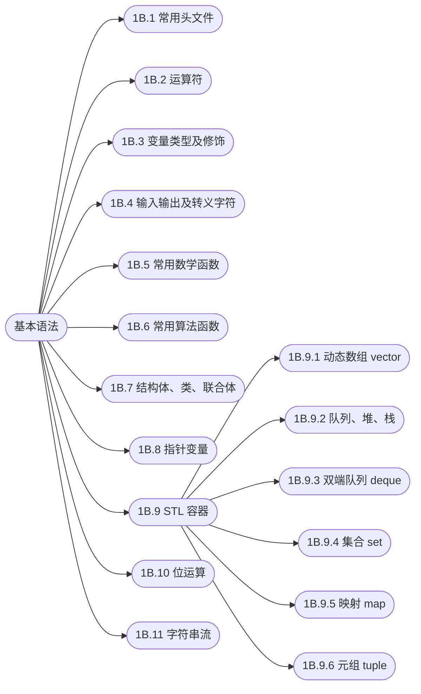

## 基本语法

[**返回上一页**](https://cuberxl.github.io/Coders-Note/)

[**返回首页**](https://cuberxl.github.io/Coders-Note/)

---

#### 基本语法

**概念**：本章覆盖 C++ 语言的语法基础与竞赛常用工具：头文件、运算符、变量类型、输入输出、数学函数、算法函数、自定义类型、指针、STL 容器、位运算与字符串流。

**策略**：这些内容是后续所有算法篇章的前置条件，建议按顺序通读一遍，之后仅把本表当作速查索引。

| 编号 | 简介 |
| :--- | :--- |
| 1B.1 | 标准库头文件与 `bits/stdc++.h` |
| 1B.2 | 算术、关系、逻辑、位运算等运算符 |
| 1B.3 | 整型/浮点/字符/布尔及 `const`、`static` 等修饰 |
| 1B.4 | `cin`/`cout`、`scanf`/`printf`、转义字符 |
| 1B.5 | 绝对值、对数、幂运算、取整、三角函数 |
| 1B.6 | `sort`、`reverse`、`unique`、二分查找、排列、内存操作 |
| 1B.7 | 定义、构造/析构、继承多态、友元、静态成员、联合体 |
| 1B.8 | 指针运算、动态内存分配 |
| 1B.9 | STL 容器 ( `vector`、`queue`/`stack`、`deque`、`set`、`map`、`tuple` ) |
| 1B.10 | 与或非异或、移位、相关应用、集合操作 |
| 1B.11 | `stringstream`、格式化字符串流 |

---

#### 章节结构

---

#### 跳转链接

- [1B.1 常用头文件](https://cuberxl.github.io/Coders-Note/1B-基本语法/1B.1-常用头文件)
- [1B.2 运算符](https://cuberxl.github.io/Coders-Note/1B-基本语法/1B.2-运算符)
- [1B.3 变量类型及修饰](https://cuberxl.github.io/Coders-Note/1B-基本语法/1B.3-变量类型及修饰)
- [1B.4 输入输出及转义字符](https://cuberxl.github.io/Coders-Note/1B-基本语法/1B.4-输入输出及转义字符)
- [1B.5 常用数学函数](https://cuberxl.github.io/Coders-Note/1B-基本语法/1B.5-常用数学函数)
- [1B.6 常用算法函数](https://cuberxl.github.io/Coders-Note/1B-基本语法/1B.6-常用算法函数)
- [1B.7 结构体、类、联合体](https://cuberxl.github.io/Coders-Note/1B-基本语法/1B.7-结构体、类、联合体)
- [1B.8 指针变量](https://cuberxl.github.io/Coders-Note/1B-基本语法/1B.8-指针变量)
- [1B.9 STL 容器](https://cuberxl.github.io/Coders-Note/1B-基本语法/1B.9-STL容器/)
- [1B.10 位运算](https://cuberxl.github.io/Coders-Note/1B-基本语法/1B.10-位运算)
- [1B.11 字符串流](https://cuberxl.github.io/Coders-Note/1B-基本语法/1B.11-字符串流)
