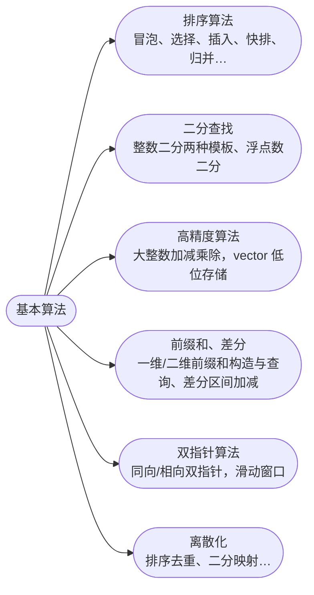

## 基本算法

[**返回上一页**](https://cuberxl.github.io/Coders-Note/)

[**返回首页**](https://cuberxl.github.io/Coders-Note/)

---

#### 基本算法

> 基础算法思想与模板

| 编号 | 简介 |
| :--- | :--- |
| 2.1 | 冒泡、选择、插入、快排、归并、计数排序的思想与复杂度 |
| 2.2 | 整数二分两种模板、浮点数二分 |
| 2.3 | 大整数加减乘除，vector 低位存储 |
| 2.4 | 一维/二维前缀和构造与查询、差分区间加减 |
| 2.5 | 同向/相向双指针，滑动窗口 |
| 2.6 | 排序去重、二分映射、树状数组/差分中的应用 |

---

#### 章节结构

---

#### 跳转链接

- [2.1 排序算法](https://cuberxl.github.io/Coders-Note/2-基本算法/2.1-排序算法)
- [2.2 二分查找](https://cuberxl.github.io/Coders-Note/2-基本算法/2.2-二分查找)
- [2.3 高精度算法](https://cuberxl.github.io/Coders-Note/2-基本算法/2.3-高精度算法)
- [2.4 前缀和、差分](https://cuberxl.github.io/Coders-Note/2-基本算法/2.4-前缀和、差分)
- [2.5 双指针算法](https://cuberxl.github.io/Coders-Note/2-基本算法/2.5-双指针算法)
- [2.6 离散化](https://cuberxl.github.io/Coders-Note/2-基本算法/2.6-离散化)
