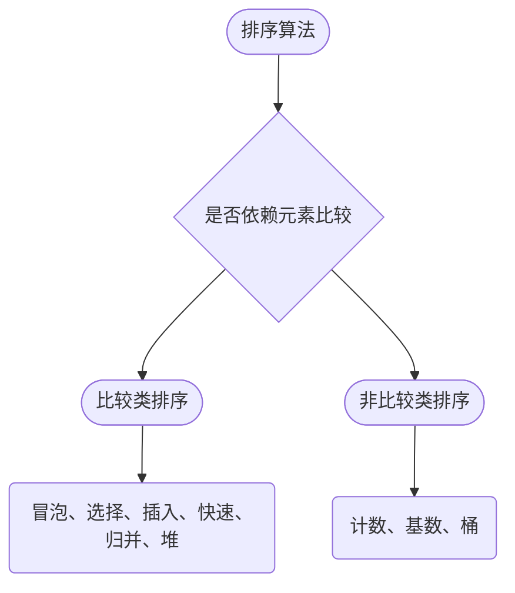

## 排序算法

[**返回上一页**](https://cuberxl.github.io/Coders-Note/2B-基本算法/)

[**返回首页**](https://cuberxl.github.io/Coders-Note/)

---

#### 排序算法

**概念**：排序是把无序序列调整为按关键字单调有序序列的过程。竞赛中绝大多数题目要么直接要求排序，要么把排序作为其他算法的前置步骤。

**分类**：按是否依赖元素之间的比较，可分为比较类排序与非比较类排序。



**定义**：若排序前后相等元素的相对次序保持不变，则该排序算法是稳定的，否则是不稳定的。稳定性只在需要保留原始次序的多关键字排序中有意义，例如先按成绩、再按学号排序。

**分析**：比较类排序的下界是 $\Omega(n \log n)$，归并排序与堆排序都能达到这一下界；非比较类排序依靠值域信息绕过比较，在值域较小时可做到线性时间。

---

#### 冒泡排序

**定义**：冒泡排序 ( bubble sort ) 反复比较相邻的两个元素，若逆序则交换，每一轮都会把当前未排序部分的最大元素送到末尾。

**思想**：把最大元素想象成气泡，每轮向序列末端“上浮”一格，直到全部元素归位。

**流程**：外层共执行 $n-1$ 轮；每轮从序列首端开始，比较相邻元素，逆序则 `swap`；若某一轮没有发生任何交换，说明序列已经有序，可提前结束。

**分析**：最好情况是序列本身有序，只需一轮即可判定，时间复杂度 $O(n)$；最坏与平均情况均为 $O(n^2)$。只需常数个额外变量，空间复杂度 $O(1)$，且相等元素不会交换，因此是稳定排序。

```cpp
void bubble_sort(int a[], int n) {
    for (int i = 0; i < n - 1; i++) {
        bool swapped = false;
        for (int j = 0; j < n - i - 1; j++) {
            if (a[j] > a[j + 1]) {
                swap(a[j], a[j + 1]);
                swapped = true;
            }
        }
        if (!swapped) break;
    }
}
```

---

#### 选择排序

**定义**：选择排序 ( selection sort ) 每一轮从未排序区间中选出最小元素，与未排序区间的首元素交换。

**思想**：把序列划分为已排序前缀与未排序后缀，每轮让前缀长度增加一，直到后缀为空。

**流程**：第 $i$ 轮在区间 $[i, n-1]$ 中找到最小元素的下标 $min\_idx$，交换 $a[i]$ 与 $a[min\_idx]$。

**分析**：无论数据如何分布，比较次数恒为 $n(n-1)/2$，时间复杂度 $O(n^2)$；空间复杂度 $O(1)$。由于交换跨越较长距离，相等元素的相对次序可能被破坏，因此不稳定，例如序列 $[2, 2, 1]$ 排序后两个 $2$ 的次序反转。

```cpp
void selection_sort(int a[], int n) {
    for (int i = 0; i < n - 1; i++) {
        int min_idx = i;
        for (int j = i + 1; j < n; j++) {
            if (a[j] < a[min_idx]) {
                min_idx = j;
            }
        }
        swap(a[i], a[min_idx]);
    }
}
```

---

#### 插入排序

**定义**：插入排序 ( insertion sort ) 维护一个有序前缀，把当前元素插入到该前缀中的正确位置。

**思想**：类似整理扑克牌，每拿到一张新牌，就从右往左与手中的牌比较，插到合适的位置。

**流程**：从第二个元素开始，取出 $key = a[i]$，在已排序前缀中从后往前找到第一个不大于 $key$ 的位置，把 $key$ 放到它后面。

**分析**：最好情况 $O(n)$ ( 序列已基本有序 )，最坏与平均 $O(n^2)$ ( 逆序 )，空间 $O(1)$。因为只在严格大于时才后移，相等元素不会越过彼此，所以稳定。

**应用**：插入排序常数极小，在 $n$ 较小或序列近乎有序时往往快于快速排序，因此常被用作快速排序小区间上的收尾优化。

```cpp
void insertion_sort(int a[], int n) {
    for (int i = 1; i < n; i++) {
        int key = a[i];
        int j = i - 1;
        while (j >= 0 && a[j] > key) {
            a[j + 1] = a[j];
            j--;
        }
        a[j + 1] = key;
    }
}
```

---

#### 快速排序

**定义**：快速排序 ( quick sort ) 是分治算法，选取一个枢轴元素，把序列划分成小于枢轴与大于枢轴的两部分，再对两部分递归排序。

**思想**：每一轮只保证枢轴归位，其余元素被分到枢轴两侧，从而把问题规模缩小。

**流程**：取区间中点值为枢轴 $x$；双指针从两端向中间扫描，遇到逆序则交换；指针相遇后分别递归左右区间。

**分析**：平均时间复杂度 $O(n \log n)$，最坏 $O(n^2)$，发生在枢轴每次都取到区间最值时；递归栈深度平均 $O(\log n)$、最坏 $O(n)$。划分时的交换是长距离的，因此不稳定。

**优化**：随机选取枢轴或三数取中，可把最坏情况的概率压到极低；小区间改用插入排序，可减少递归开销。

```cpp
void quick_sort(int a[], int l, int r) {
    if (l >= r) return;
    int i = l - 1, j = r + 1, x = a[l + r >> 1];
    while (i < j) {
        do i++; while (a[i] < x);
        do j--; while (a[j] > x);
        if (i < j) swap(a[i], a[j]);
    }
    quick_sort(a, l, j);
    quick_sort(a, j + 1, r);
}
```

---

#### 归并排序

**定义**：归并排序 ( merge sort ) 把序列二分成两个子序列，分别排序后再合并成一个有序序列。

**思想**：分治到只剩单个元素时天然有序，回溯时只需把两个有序段线性合并。

**流程**：递归二分至 $l \ge r$；用双指针分别扫描左右两段，每次取较小者放入辅助数组；把辅助数组中的结果写回原区间。

**分析**：无论数据分布如何，递归树深度为 $\log n$，每层合并总代价 $O(n)$，因此时间复杂度恒为 $O(n \log n)$；需要长度为 $n$ 的辅助数组，空间复杂度 $O(n)$。合并时左段优先，相等元素次序不变，因此稳定。

**应用**：归并排序的合并过程天然能统计逆序对数量，是求解逆序对问题的标准做法之一。

```cpp
int tmp[1000010];

void merge_sort(int a[], int l, int r) {
    if (l >= r) return;
    int mid = l + r >> 1;
    merge_sort(a, l, mid);
    merge_sort(a, mid + 1, r);

    int k = 0, i = l, j = mid + 1;
    while (i <= mid && j <= r) {
        if (a[i] <= a[j]) tmp[k++] = a[i++];
        else tmp[k++] = a[j++];
    }
    while (i <= mid) tmp[k++] = a[i++];
    while (j <= r) tmp[k++] = a[j++];
    for (i = l, j = 0; i <= r; i++, j++) a[i] = tmp[j];
}
```

---

#### 计数排序

**定义**：计数排序 ( counting sort ) 以下标表示数值，统计每个数值出现的次数，再按数值从小到大依次回填，属于非比较类排序。

**思想**：当值域 $k$ 远小于元素个数时，直接用“值”作下标可以省去比较。

**流程**：先求出序列最大值确定值域；清空计数数组并统计每个值出现的频次；从小到大遍历值域，把每个值重复写入原数组。

**分析**：时间复杂度 $O(n + k)$，空间复杂度 $O(k)$，其中 $k$ 为值域大小。按值从小到大回填时相等元素的相对次序不会被改变，因此稳定。

**注意**：值域过大 ( 例如 $10^9$ ) 时计数数组无法开下，此时应改用比较类排序或离散化。

```cpp
int cnt[1000010];

void counting_sort(int a[], int n) {
    int max_val = 0;
    for (int i = 0; i < n; i++) {
        if (a[i] > max_val) max_val = a[i];
    }

    for (int i = 0; i <= max_val; i++) cnt[i] = 0;
    for (int i = 0; i < n; i++) cnt[a[i]]++;

    int j = 0;
    for (int i = 0; i <= max_val; i++) {
        while (cnt[i] > 0) {
            a[j++] = i;
            cnt[i]--;
        }
    }
}
```

---

#### 堆排序

**定义**：堆排序 ( heap sort ) 先把序列建成大根堆，再反复把堆顶与末尾元素交换并重新下沉调整，从而逐个确定最大值。

**思想**：大根堆的堆顶恒为当前最大值，把堆顶换到末尾相当于“取出”最大值，问题规模缩小一。

**流程**：从最后一个非叶结点向前执行下沉操作建堆，时间复杂度 $O(n)$；随后交换堆顶与第 $i$ 个元素，把前 $i$ 个元素重新下沉调整。

**分析**：建堆 $O(n)$，之后 $n-1$ 次调整每次 $O(\log n)$，总时间复杂度恒为 $O(n \log n)$；原地排序，空间复杂度 $O(1)$。下沉时交换可能跨越较远距离，因此不稳定。

**应用**：在只需求出前 $k$ 大元素时，维护大小为 $k$ 的堆即可把复杂度降到 $O(n \log k)$。

```cpp
void down(int a[], int n, int i) {
    int largest = i;
    int left = 2 * i + 1;
    int right = 2 * i + 2;

    if (left < n && a[left] > a[largest]) largest = left;
    if (right < n && a[right] > a[largest]) largest = right;

    if (largest != i) {
        swap(a[i], a[largest]);
        down(a, n, largest);
    }
}

void heap_sort(int a[], int n) {
    for (int i = n / 2 - 1; i >= 0; i--) {
        down(a, n, i);
    }
    for (int i = n - 1; i > 0; i--) {
        swap(a[0], a[i]);
        down(a, i, 0);
    }
}
```

---

#### 基数排序

**定义**：基数排序 ( radix sort ) 把所有整数按十进制位拆开，从最低位到最高位逐位排序，属于非比较类排序。

**思想**：高位权重大于低位，因此先按低位排好序，再按高位稳定地重排，低位已经形成的次序会被保留下来。

**流程**：求出最大数确定位数；从 $exp = 1$ 开始，每轮以 $(a[i] / exp) \bmod 10$ 作为关键字做一次计数排序；$exp$ 乘 $10$ 直到超过最大数。

**分析**：时间复杂度 $O(d(n + k))$，其中 $d$ 为最大位数、$k$ 为基数，十进制下 $k = 10$；空间复杂度 $O(n + k)$。每轮都是稳定排序且按位从低到高处理，因此整体稳定。

```cpp
int output[1000010];

void radix_sort(int a[], int n) {
    int max_val = 0;
    for (int i = 0; i < n; i++) {
        if (a[i] > max_val) max_val = a[i];
    }

    for (int exp = 1; max_val / exp > 0; exp *= 10) {
        int cnt[10] = {0};

        for (int i = 0; i < n; i++) cnt[(a[i] / exp) % 10]++;
        for (int i = 1; i < 10; i++) cnt[i] += cnt[i - 1];

        for (int i = n - 1; i >= 0; i--) {
            output[cnt[(a[i] / exp) % 10] - 1] = a[i];
            cnt[(a[i] / exp) % 10]--;
        }
        for (int i = 0; i < n; i++) a[i] = output[i];
    }
}
```

---

#### 桶排序

**定义**：桶排序 ( bucket sort ) 把值域均匀划分为若干个区间，每个区间对应一个桶，元素按值落入对应桶中，桶内单独排序后再按桶序收集。

**思想**：当数据均匀分布时，每个桶内的元素个数约为 $n / k$，桶内排序的总代价降为线性。

**流程**：求出最大值以确定映射比例；用 $a[i] \times k / (max\_val + 1)$ 把元素映射到 $k$ 个桶；对每个桶内部执行插入排序；按桶的先后顺序收集结果。

**分析**：平均时间复杂度 $O(n + k)$，最坏 $O(n^2)$，发生在所有元素落入同一个桶时；空间复杂度 $O(n + k)$。稳定性取决于桶内所用的排序算法，桶内使用插入排序时整体稳定。

```cpp
int bucket[15][100010];
int bucket_size[15];

void bucket_sort(int a[], int n) {
    int max_val = 0;
    for (int i = 0; i < n; i++) {
        if (a[i] > max_val) max_val = a[i];
    }

    for (int i = 0; i <= 10; i++) bucket_size[i] = 0;

    for (int i = 0; i < n; i++) {
        int idx = (long long)a[i] * 10 / (max_val + 1);
        bucket[idx][bucket_size[idx]++] = a[i];
    }

    for (int i = 0; i < 10; i++) {
        for (int j = 1; j < bucket_size[i]; j++) {
            int key = bucket[i][j];
            int k = j - 1;
            while (k >= 0 && bucket[i][k] > key) {
                bucket[i][k + 1] = bucket[i][k];
                k--;
            }
            bucket[i][k + 1] = key;
        }
    }

    int idx = 0;
    for (int i = 0; i < 10; i++) {
        for (int j = 0; j < bucket_size[i]; j++) {
            a[idx++] = bucket[i][j];
        }
    }
}
```

---

#### 复杂度汇总

| 算法 | 平均时间 | 最坏时间 | 空间 | 稳定性 |
| :--- | :--- | :--- | :--- | :--- |
| 冒泡排序 | $O(n^2)$ | $O(n^2)$ | $O(1)$ | 稳定 |
| 选择排序 | $O(n^2)$ | $O(n^2)$ | $O(1)$ | 不稳定 |
| 插入排序 | $O(n^2)$ | $O(n^2)$ | $O(1)$ | 稳定 |
| 快速排序 | $O(n \log n)$ | $O(n^2)$ | $O(\log n)$ | 不稳定 |
| 归并排序 | $O(n \log n)$ | $O(n \log n)$ | $O(n)$ | 稳定 |
| 计数排序 | $O(n + k)$ | $O(n + k)$ | $O(k)$ | 稳定 |
| 堆排序 | $O(n \log n)$ | $O(n \log n)$ | $O(1)$ | 不稳定 |
| 基数排序 | $O(d(n + k))$ | $O(d(n + k))$ | $O(n + k)$ | 稳定 |
| 桶排序 | $O(n + k)$ | $O(n^2)$ | $O(n + k)$ | 视桶内算法 |

**结论**：需要稳定且数据量较大时用归并排序；只需平均性能时用快速排序；内存紧张时用堆排序；值域很小时用计数排序或基数排序。
