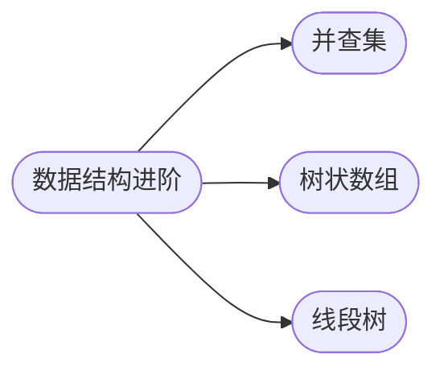

## 数据结构进阶

[**返回上一页**](https://cuberxl.github.io/Coders-Note/)

[**返回首页**](https://cuberxl.github.io/Coders-Note/)

---

#### 数据结构进阶

> 基础数据结构的扩展与高级应用

| 编号 | 简介 |
| :--- | :--- |
| 3\*.1 | 集合合并与查询、路径压缩、按秩合并、带权并查集 |
| 3\*.2 | 树状数组维护前缀和、单点修改、区间查询、求逆序对 |
| 3\*.3 | 基于分治的二叉树结构，区间信息统计，懒标记 |

---

#### 章节结构

---

#### 跳转链接

- [3\*.1 并查集](https://cuberxl.github.io/Coders-Note/3*-数据结构进阶/3*.1-并查集)
- [3\*.2 树状数组](https://cuberxl.github.io/Coders-Note/3*-数据结构进阶/3*.2-树状数组)
- [3\*.3 线段树](https://cuberxl.github.io/Coders-Note/3*-数据结构进阶/3*.3-线段树)
