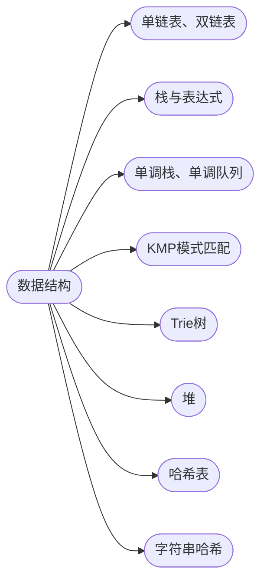

## 数据结构

[**返回上一页**](https://cuberxl.github.io/Coders-Note/)

[**返回首页**](https://cuberxl.github.io/Coders-Note/)

---

#### 数据结构

> 常用数据结构实现与应用

| 编号 | 简介 |
| :--- | :--- |
| 3B.1 | 数组模拟链表，e/ne 存储与遍历 |
| 3B.2 | 中缀、后缀表达式与求值 |
| 3B.3 | 左边更小数、滑动窗口最值，$O(n)$ |
| 3B.4 | next 数组计算、匹配过程、避免回溯 |
| 3B.5 | 字符串存储与查找、二进制 Trie 求最大异或对 |
| 3B.6 | down/up 操作、建堆 $O(n)$、堆排序 |
| 3B.7 | 拉链法、开放寻址法、查找/插入/删除 |
| 3B.8 | 前缀哈希、子串查询 |

---

#### 章节结构

---

#### 跳转链接

- [3B.1 单链表、双链表](https://cuberxl.github.io/Coders-Note/3B-数据结构/3B.1-单链表、双链表)
- [3B.2 栈与表达式](https://cuberxl.github.io/Coders-Note/3B-数据结构/3B.2-栈与表达式)
- [3B.3 单调栈、单调队列](https://cuberxl.github.io/Coders-Note/3B-数据结构/3B.3-单调栈、单调队列)
- [3B.4 KMP模式匹配](https://cuberxl.github.io/Coders-Note/3B-数据结构/3B.4-KMP模式匹配)
- [3B.5 Trie树](https://cuberxl.github.io/Coders-Note/3B-数据结构/3B.5-Trie树)
- [3B.6 堆](https://cuberxl.github.io/Coders-Note/3B-数据结构/3B.6-堆)
- [3B.7 哈希表](https://cuberxl.github.io/Coders-Note/3B-数据结构/3B.7-哈希表)
- [3B.8 字符串哈希](https://cuberxl.github.io/Coders-Note/3B-数据结构/3B.8-字符串哈希)
