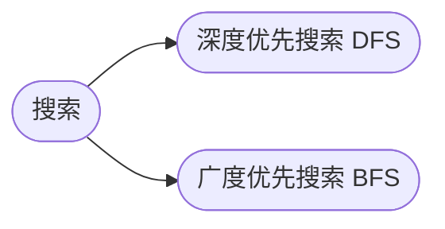

## 搜索

[**返回上一页**](https://cuberxl.github.io/Coders-Note/)

[**返回首页**](https://cuberxl.github.io/Coders-Note/)

---

#### 搜索

> DFS 与 BFS

| 编号 | 简介 |
| :--- | :--- |
| 4.1 | 回溯思想、N皇后、排列枚举；空间 $O(h)$，不具最短性 |
| 4.2 | 走迷宫、八数码；边权为1时具最短路径性质，空间 $O(2^n)$ |

---

#### 章节结构

---

#### 跳转链接

- [4.1 深度优先搜索 DFS](https://cuberxl.github.io/Coders-Note/4-搜索/4.1-深度优先搜索DFS)
- [4.2 广度优先搜索 BFS](https://cuberxl.github.io/Coders-Note/4-搜索/4.2-广度优先搜索BFS)
