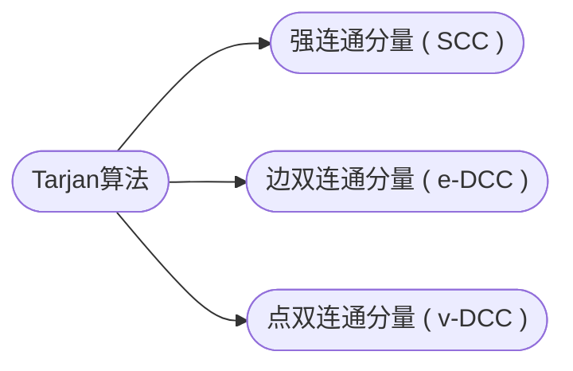

## Tarjan算法

[**返回上一页**](https://cuberxl.github.io/Coders-Note/5star-图论进阶/)

[**返回首页**](https://cuberxl.github.io/Coders-Note/)

---

#### Tarjan算法

> 图的连通性算法

| 编号 | 简介 |
| :--- | :--- |
| 5\*.5.1 | 强连通分量 ( SCC ) |
| 5\*.5.2 | 边双连通分量 ( e-DCC ) |
| 5\*.5.3 | 点双连通分量 ( v-DCC ) |

---

#### 章节结构

---

#### 跳转链接

- [5\*.5.1 强连通分量 ( SCC )](https://cuberxl.github.io/Coders-Note/5*-图论进阶/5*.5-Tarjan算法/5*.5.1-强连通分量（SCC）)
- [5\*.5.2 边双连通分量 ( e-DCC )](https://cuberxl.github.io/Coders-Note/5*-图论进阶/5*.5-Tarjan算法/5*.5.2-边双连通分量（e-DCC）)
- [5\*.5.3 点双连通分量 ( v-DCC )](https://cuberxl.github.io/Coders-Note/5*-图论进阶/5*.5-Tarjan算法/5*.5.3-点双连通分量（v-DCC）)
