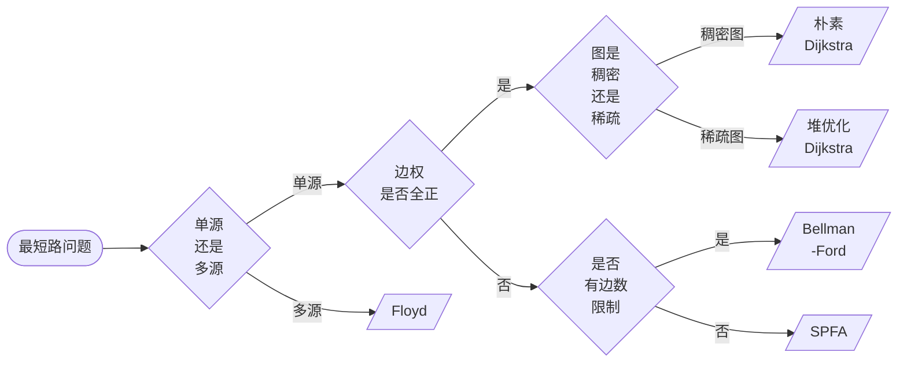

## 最短路算法

[**返回上一页**](https://cuberxl.github.io/Coders-Note/5-图论/)

[**返回首页**](https://cuberxl.github.io/Coders-Note/)

---

#### 最短路算法

**定义**：在图中求两点之间边权之和最小的路径。

**分类**：

| 类型 | 说明 |
|:---|:---|
| 单源最短路 | 从一个起点到其他所有点的最短路 |
| 多源汇最短路 | 任意两点之间的最短路 |

**算法总览**：

| 最短路类型 | 算法名称 | 时间复杂度 | 适用场景 |
| :--- | :--- | :--- | :--- |
| **单源最短路** | 朴素 Dijkstra 算法 | $O(n^2)$ | 边权均为正，稠密图 |
| **单源最短路** | 堆优化 Dijkstra 算法 | $O(m \log n)$ | 边权均为正，稀疏图 |
| **单源最短路** | Bellman-Ford 算法 | $O(nm)$ | 存在负权边和有边数限制 |
| **单源最短路** | SPFA 算法 | 一般 $O(m)$，最坏 $O(nm)$ | 存在负权边 |
| **多源汇最短路** | Floyd 算法 | $O(n^3)$ | 全局最短路 |

**算法选择逻辑**：

---

#### 📌 跳转链接

- [5.3.1 Dijkstra算法](https://cuberxl.github.io/Coders-Note/5-图论/5.3-最短路算法/5.3.1-Dijkstra算法)
- [5.3.2 Bellman-Ford算法](https://cuberxl.github.io/Coders-Note/5-图论/5.3-最短路算法/5.3.2-Bellman-Ford算法)
- [5.3.3 SPFA算法](https://cuberxl.github.io/Coders-Note/5-图论/5.3-最短路算法/5.3.3-SPFA算法)
- [5.3.4 Floyd算法](https://cuberxl.github.io/Coders-Note/5-图论/5.3-最短路算法/5.3.4-Floyd算法)
<!--stackedit_data:
eyJoaXN0b3J5IjpbLTE1NDUyMDE1ODJdfQ==
-->