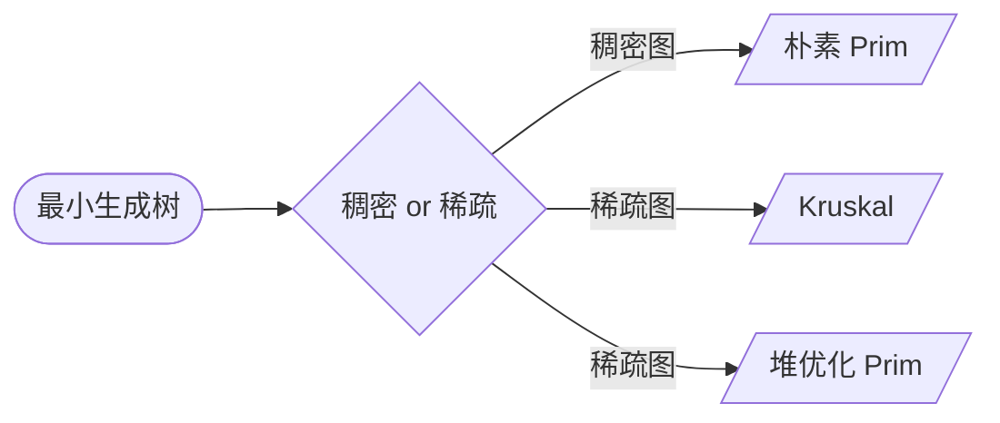

## 最小生成树算法

[**返回上一页**](https://cuberxl.github.io/Coders-Note/5B-图论/)

[**返回首页**](https://cuberxl.github.io/Coders-Note/)

---

#### 最小生成树算法

- **定义**：在连通无向图中，选出 $n-1$ 条边，使所有顶点连通且总权值最小。

- **算法总览**：

| 算法名称 | 时间复杂度 | 适用场景 |
| :--- | :--- | :--- |
| 朴素 Prim 算法 | $O(n^2)$ | 稠密图 |
| 堆优化 Prim 算法 | $O(m \log n)$ | 稀疏图 |
| Kruskal 算法 | $O(m \log m)$ | 稀疏图 |

- **算法选择逻辑**：

---

#### 跳转链接

- [5B.4.1 Prim算法](https://cuberxl.github.io/Coders-Note/5B-图论/5.4-最小生成树/5.4.1-Prim算法)
- [5B.4.2 Kruskal算法](https://cuberxl.github.io/Coders-Note/5B-图论/5.4-最小生成树/5.4.2-Kruskal算法)
