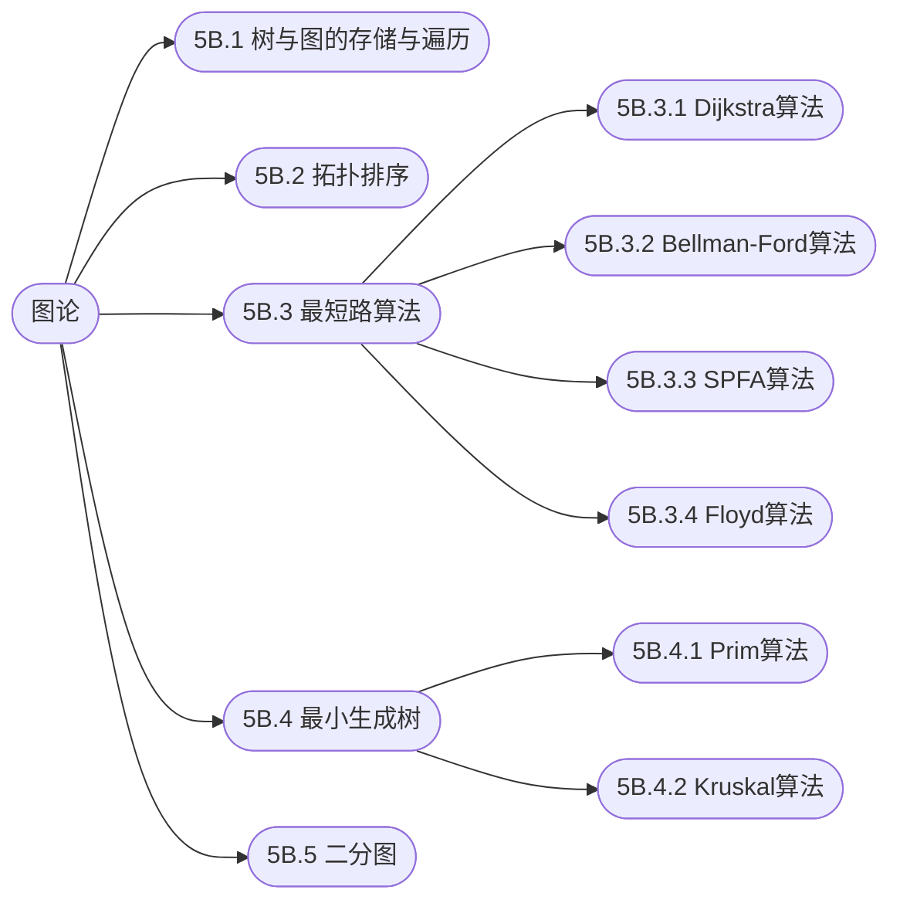

## 图论

[**返回上一页**](https://cuberxl.github.io/Coders-Note/)

[**返回首页**](https://cuberxl.github.io/Coders-Note/)

---

#### 图论

> 图的基础与最短路算法

| 编号 | 简介 |
| :--- | :--- |
| 5B.1 | 树与图的存储与遍历 |
| 5B.2 | 拓扑排序 |
| 5B.3 | 最短路算法 |
| 5B.4 | 最小生成树 |
| 5B.5 | 二分图 |

---

#### 章节结构

---

#### 跳转链接

- [5B.1 树与图的存储与遍历](https://cuberxl.github.io/Coders-Note/5B-图论/5B.1-树与图的存储与遍历)
- [5B.2 拓扑排序](https://cuberxl.github.io/Coders-Note/5B-图论/5B.2-拓扑排序)
- [5B.3 最短路算法](https://cuberxl.github.io/Coders-Note/5B-图论/5B.3-最短路算法/)
- [5B.4 最小生成树](https://cuberxl.github.io/Coders-Note/5B-图论/5B.4-最小生成树)
- [5B.5 二分图](https://cuberxl.github.io/Coders-Note/5B-图论/5B.5-二分图)
