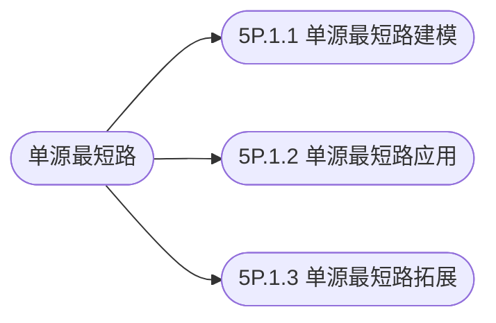

## 单源最短路

[**返回上一页**](https://cuberxl.github.io/Coders-Note/5P-图论进阶/)

[**返回首页**](https://cuberxl.github.io/Coders-Note/)

---

#### 单源最短路

> 单源最短路的建模、应用与拓展

| 编号 | 简介 |
| :--- | :--- |
| 5P.1.1 | 单源最短路建模 |
| 5P.1.2 | 单源最短路应用 |
| 5P.1.3 | 单源最短路拓展 |

---

#### 章节结构

---

#### 跳转链接

- [5P.1.1 单源最短路建模](https://cuberxl.github.io/Coders-Note/5P-图论进阶/5P.1-单源最短路/5P.1.1-单源最短路建模)
- [5P.1.2 单源最短路应用](https://cuberxl.github.io/Coders-Note/5P-图论进阶/5P.1-单源最短路/5P.1.2-单源最短路应用)
- [5P.1.3 单源最短路拓展](https://cuberxl.github.io/Coders-Note/5P-图论进阶/5P.1-单源最短路/5P.1.3-单源最短路拓展)
