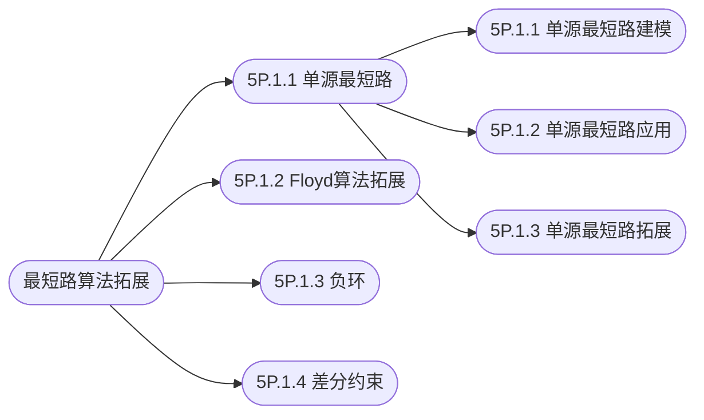

## 最短路算法拓展
#### *Extensions of Shortest Path Algorithms*

---

[**返回上一页**](https://cuberxl.github.io/Coders-Note/5P-图论进阶/)

[**返回首页**](https://cuberxl.github.io/Coders-Note/)

---

#### $\S$ 最短路算法拓展

> 单源最短路的建模、应用与拓展

| 编号 | 简介 |
| :--- | :--- |
| 5P.1.1 | 单源最短路 ( 建模、应用、拓展 ) |
| 5P.1.2 | Floyd 算法的拓展应用 |
| 5P.1.3 | 负环的判定 |
| 5P.1.4 | 差分约束 |

---

#### $\S$ 章节结构

---

#### $\S$ 跳转链接

- [5P.1.1 单源最短路](https://cuberxl.github.io/Coders-Note/5P-图论进阶/5P.1-最短路算法拓展/5P.1.1-单源最短路/)
- [5P.1.2 Floyd算法拓展](https://cuberxl.github.io/Coders-Note/5P-图论进阶/5P.1-最短路算法拓展/5P.1.2-Floyd算法拓展)
- [5P.1.3 负环](https://cuberxl.github.io/Coders-Note/5P-图论进阶/5P.1-最短路算法拓展/5P.1.3-负环)
- [5P.1.4 差分约束](https://cuberxl.github.io/Coders-Note/5P-图论进阶/5P.1-最短路算法拓展/5P.1.4-差分约束)
