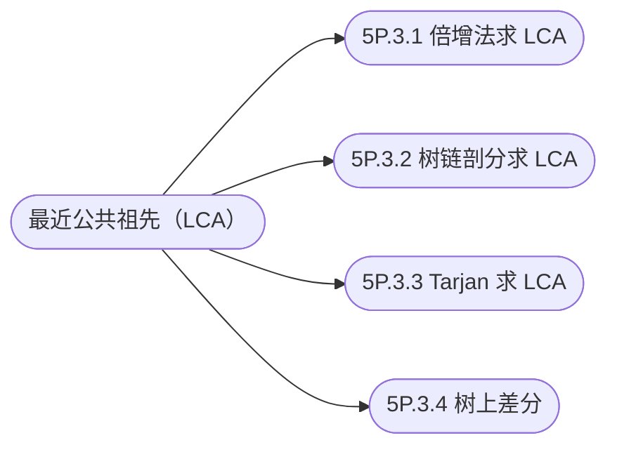

## 最近公共祖先（LCA）

[**返回上一页**](https://cuberxl.github.io/Coders-Note/5P-图论进阶/)

[**返回首页**](https://cuberxl.github.io/Coders-Note/)

---

#### 最近公共祖先（LCA）

**概念**：树上两点 $u, v$ 的所有公共祖先中，深度最大的那个称为最近公共祖先。

---

#### 章节结构

---

#### 跳转链接

- [5P.3.1 倍增法求 LCA](https://cuberxl.github.io/Coders-Note/5P-图论进阶/5P.2-树上问题/5P.2.3-最近公共祖先/5P.2.3.1-倍增法求LCA)
- [5P.3.2 树链剖分求 LCA](https://cuberxl.github.io/Coders-Note/5P-图论进阶/5P.2-树上问题/5P.2.3-最近公共祖先/5P.2.3.2-树链剖分求LCA)
- [5P.3.3 Tarjan 求 LCA](https://cuberxl.github.io/Coders-Note/5P-图论进阶/5P.2-树上问题/5P.2.3-最近公共祖先/5P.2.3.3-Tarjan求LCA)
- [5P.3.4 树上差分](https://cuberxl.github.io/Coders-Note/5P-图论进阶/5P.2-树上问题/5P.2.4-树上差分)
