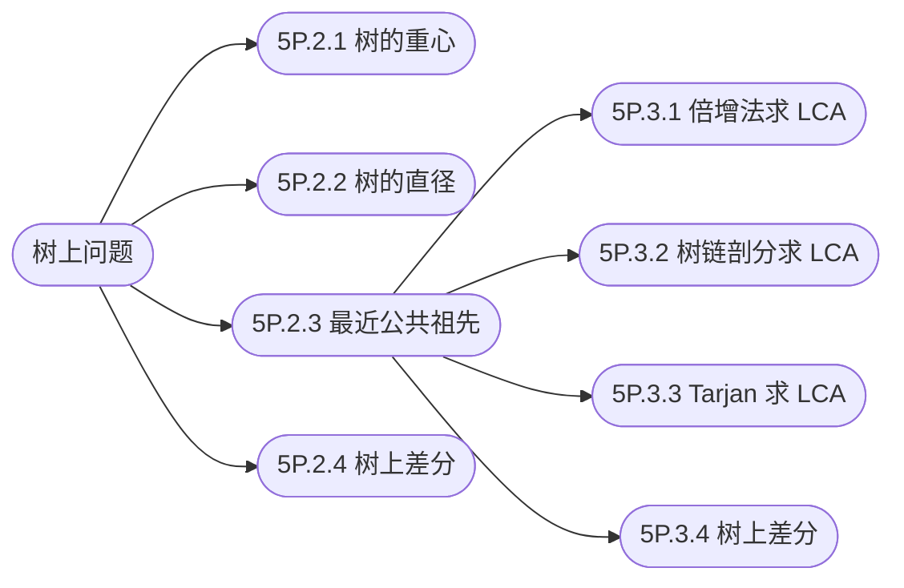

## 树上问题
#### *Problems on Trees*

[**返回上一页**](https://cuberxl.github.io/Coders-Note/5P-图论进阶/)

[**返回首页**](https://cuberxl.github.io/Coders-Note/)

---

#### $\S$ 树上问题

> 树的结构性质与树上算法

| 编号 | 简介 |
| :--- | :--- |
| 5P.2.1 | 树的重心 |
| 5P.2.2 | 树的直径 |
| 5P.2.3 | 最近公共祖先 ( LCA ) |
| 5P.2.4 | 树上差分 |

---

#### $\S$ 章节结构

---

#### $\S$ 跳转链接

- [5P.2.1 树的重心](https://cuberxl.github.io/Coders-Note/5P-图论进阶/5P.2-树上问题/5P.2.1-树的重心)
- [5P.2.2 树的直径](https://cuberxl.github.io/Coders-Note/5P-图论进阶/5P.2-树上问题/5P.2.2-树的直径)
- [5P.2.3 最近公共祖先](https://cuberxl.github.io/Coders-Note/5P-图论进阶/5P.2-树上问题/5P.2.3-最近公共祖先/)
- [5P.2.4 树上差分](https://cuberxl.github.io/Coders-Note/5P-图论进阶/5P.2-树上问题/5P.2.4-树上差分)
