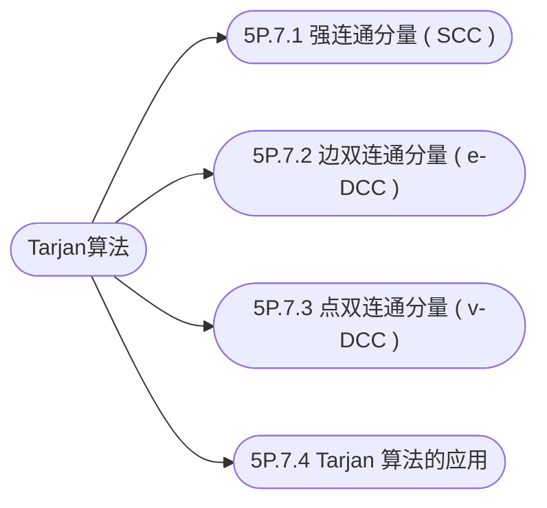

## Tarjan算法

[**返回上一页**](https://cuberxl.github.io/Coders-Note/5P-图论进阶/)

[**返回首页**](https://cuberxl.github.io/Coders-Note/)

---

#### Tarjan算法

> 图的连通性算法

| 编号 | 简介 |
| :--- | :--- |
| 5P.7.1 | 强连通分量 ( SCC ) |
| 5P.7.2 | 边双连通分量 ( e-DCC ) |
| 5P.7.3 | 点双连通分量 ( v-DCC ) |
| 5P.7.4 | Tarjan 算法的应用 |

---

#### 章节结构

---

#### 跳转链接

- [5P.7.1 强连通分量 ( SCC )](https://cuberxl.github.io/Coders-Note/5P-图论进阶/5P.3-Tarjan算法/5P.3.1-强连通分量（SCC）)
- [5P.7.2 边双连通分量 ( e-DCC )](https://cuberxl.github.io/Coders-Note/5P-图论进阶/5P.3-Tarjan算法/5P.3.2-边双连通分量（e-DCC）)
- [5P.7.3 点双连通分量 ( v-DCC )](https://cuberxl.github.io/Coders-Note/5P-图论进阶/5P.3-Tarjan算法/5P.3.3-点双连通分量（v-DCC）)
- [5P.7.4 Tarjan 算法的应用](https://cuberxl.github.io/Coders-Note/5P-图论进阶/5P.3-Tarjan算法/5P.3.4-Tarjan算法的应用)
