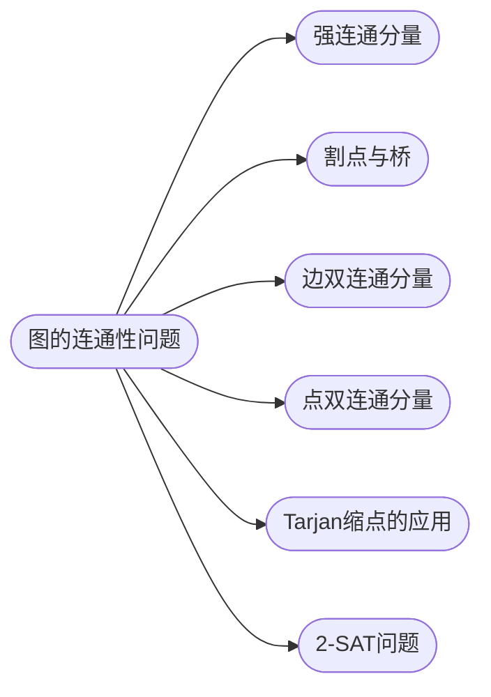

## 图的连通性问题

[**返回上一页**](https://cuberxl.github.io/Coders-Note/5P-图论进阶/)

[**返回首页**](https://cuberxl.github.io/Coders-Note/)

---

#### *Connectivity of Graphs*

---

#### $\S$ 图的连通性问题

> Tarjan 算法及其在连通性问题中的应用

| 编号 | 简介 |
| :--- | :--- |
| 5P.3.1 | 强连通分量 ( SCC ) |
| 5P.3.2 | 割点与桥 |
| 5P.3.3 | 边双连通分量 ( e-DCC ) |
| 5P.3.4 | 点双连通分量 ( v-DCC ) |
| 5P.3.5 | Tarjan 缩点的应用 |
| 5P.3.6 | 2-SAT 问题 |

---

#### $\S$ 章节结构

---

#### $\S$ 跳转链接

- [5P.3.1 强连通分量](https://cuberxl.github.io/Coders-Note/5P-图论进阶/5P.3-图的连通性问题/5P.3.1-强连通分量)
- [5P.3.2 割点与桥](https://cuberxl.github.io/Coders-Note/5P-图论进阶/5P.3-图的连通性问题/5P.3.2-割点与桥)
- [5P.3.3 边双连通分量](https://cuberxl.github.io/Coders-Note/5P-图论进阶/5P.3-图的连通性问题/5P.3.3-边双连通分量)
- [5P.3.4 点双连通分量](https://cuberxl.github.io/Coders-Note/5P-图论进阶/5P.3-图的连通性问题/5P.3.4-点双连通分量)
- [5P.3.5 Tarjan缩点的应用](https://cuberxl.github.io/Coders-Note/5P-图论进阶/5P.3-图的连通性问题/5P.3.5-Tarjan缩点的应用)
- [5P.3.6 2-SAT问题](https://cuberxl.github.io/Coders-Note/5P-图论进阶/5P.3-图的连通性问题/5P.3.6-2-SAT问题)
