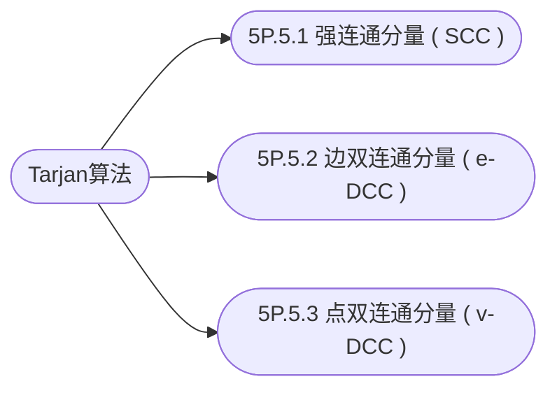

## 最近公共祖先LCA

---

[**返回上一页**](https://cuberxl.github.io/Coders-Note/5P-图论进阶/)

[**返回首页**](https://cuberxl.github.io/Coders-Note/)

---

#### 前置知识

---

**概念**：最近公共祖先。树上两点 $u, v$ 的所有公共祖先中，深度最大的那个。

Tarjan算法

> 图的连通性算法

| 编号 | 简介 |
| :--- | :--- |
| 5P.3.1 | 强连通分量 ( SCC ) |
| 5P.5.2 | 边双连通分量 ( e-DCC ) |
| 5P.5.3 | 点双连通分量 ( v-DCC ) |

---

#### 章节结构

---

#### 跳转链接

- [5P.5.1 强连通分量 ( SCC )](https://cuberxl.github.io/Coders-Note/5P-图论进阶/5P.5-Tarjan算法/5P.5.1-强连通分量（SCC）))
- [5P.5.2 边双连通分量 ( e-DCC )](https://cuberxl.github.io/Coders-Note/5P-图论进阶/5P.5-Tarjan算法/5P.5.2-边双连通分量（e-DCC）))
- [5P.5.3 点双连通分量 ( v-DCC )](https://cuberxl.github.io/Coders-Note/5P-图论进阶/5P.5-Tarjan算法/5P.5.3-点双连通分量（v-DCC）))
<!--stackedit_data:
eyJoaXN0b3J5IjpbLTUwMTY5NDgyNiwtMTQ0OTg4MTQxNywtOD
A2NDQ2NDQ3XX0=
-->