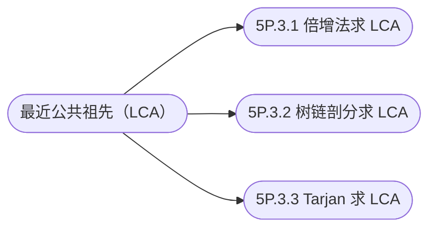

## 最近公共祖先（LCA）

[**返回上一页**](https://cuberxl.github.io/Coders-Note/5P-图论进阶/)

[**返回首页**](https://cuberxl.github.io/Coders-Note/)

---
#### 前置知识
---
**概念：** 树上两点 $u, v$ 的所有公共祖先中，深度最大的那个称为最近公共祖先。


| 编号 | 简介 |
| :--- | :--- |
| 5P.3.1 | 倍增法求 LCA |
| 5P.3.2 | 树链剖分求 LCA |
| 5P.3.3 | Tarjan 求 LCA |

## 章节结构



## 跳转链接

- [5P.3.1 倍增法求 LCA](https://cuberxl.github.io/Coders-Note/5P-图论进阶/5P.3-最近公共祖先（LCA）/5P.3.1-倍增法求LCA)
- [5P.3.2 树链剖分求 LCA](https://cuberxl.github.io/Coders-Note/5P-图论进阶/5P.3-最近公共祖先（LCA）/5P.3.2-树链剖分求LCA)
- [5P.3.3 Tarjan 求 LCA](https://cuberxl.github.io/Coders-Note/5P-图论进阶/5P.3-最近公共祖先（LCA）/5P.3.3-Tarjan求LCA)
```
<!--stackedit_data:
eyJoaXN0b3J5IjpbMjQ1OTU5OTA2XX0=
-->