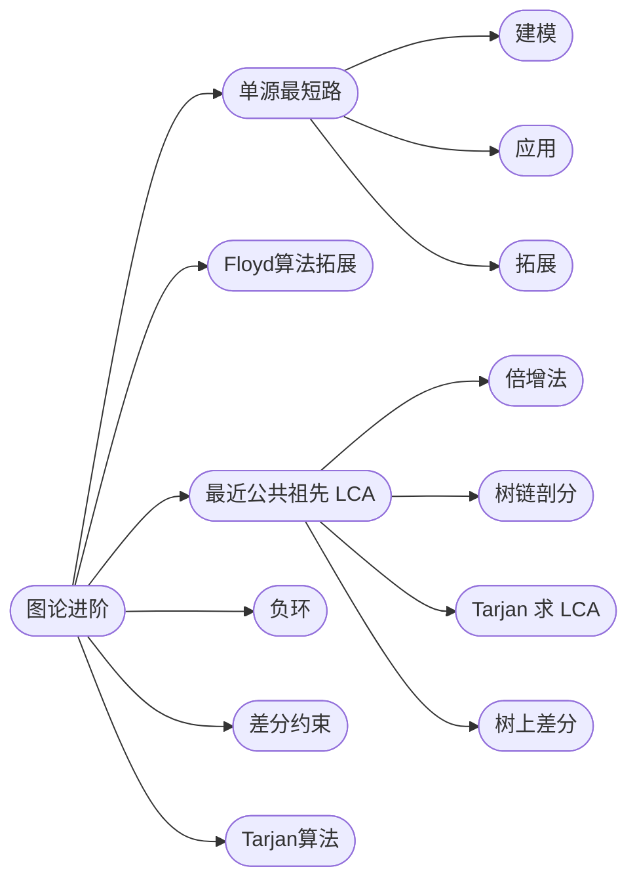

## 图论进阶

[**返回上一页**](https://cuberxl.github.io/Coders-Note/)

[**返回首页**](https://cuberxl.github.io/Coders-Note/)

---

#### 图论进阶

> 最短路算法的深入应用与扩展

| 编号 | 简介 |
| :--- | :--- |
| 5P.1 | 单源最短路的深入应用 ( 如差分约束、分层图等 ) |
| 5P.2 | Floyd 算法的拓展应用 ( 如传递闭包等 ) |
| 5P.3 | 最近公共祖先 ( LCA ) ：倍增、树链剖分、Tarjan、树上差分 |
| 5P.4 | 负环的判定 |
| 5P.5 | 差分约束 |
| 5P.7 | Tarjan 算法及其应用 |

---

#### 章节结构

---

#### 跳转链接

- [5P.1 单源最短路](https://cuberxl.github.io/Coders-Note/5P-图论进阶/5P.1-单源最短路/)
- [5P.2 Floyd算法拓展](https://cuberxl.github.io/Coders-Note/5P-图论进阶/5P.2-Floyd算法拓展)
- [5P.3 最近公共祖先 LCA](https://cuberxl.github.io/Coders-Note/5P-图论进阶/5P.3-最近公共祖先（LCA）/)
- [5P.4 负环](https://cuberxl.github.io/Coders-Note/5P-图论进阶/5P.4-负环)
- [5P.5 差分约束](https://cuberxl.github.io/Coders-Note/5P-图论进阶/5P.5-差分约束)
- [5P.7 Tarjan算法](https://cuberxl.github.io/Coders-Note/5P-图论进阶/5P.7-Tarjan算法/)
