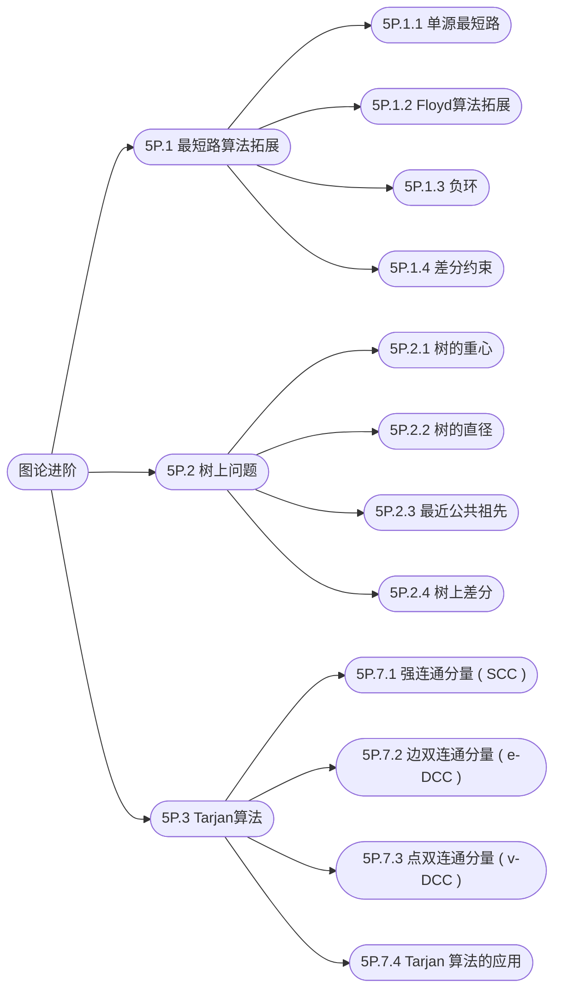

## 图论进阶

[**返回上一页**](https://cuberxl.github.io/Coders-Note/)

[**返回首页**](https://cuberxl.github.io/Coders-Note/)

---

#### 图论进阶

> 最短路算法的深入应用与扩展

| 编号 | 简介 |
| :--- | :--- |
| 5P.1 | 最短路算法拓展 ( 单源最短路、Floyd、负环、差分约束 ) |
| 5P.2 | 树上问题 ( 树的重心、树的直径、LCA、树上差分 ) |
| 5P.3 | Tarjan 算法及其应用 |

---

#### 章节结构

---

#### 跳转链接

- [5P.1 最短路算法拓展](https://cuberxl.github.io/Coders-Note/5P-图论进阶/5P.1-最短路算法拓展/)
- [5P.2 树上问题](https://cuberxl.github.io/Coders-Note/5P-图论进阶/5P.2-树上问题/)
- [5P.3 Tarjan算法](https://cuberxl.github.io/Coders-Note/5P-图论进阶/5P.3-Tarjan算法/)
