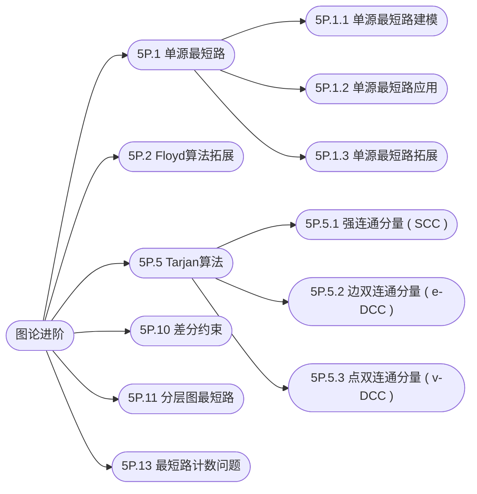

## 图论进阶

[**返回上一页**](https://cuberxl.github.io/Coders-Note/)

[**返回首页**](https://cuberxl.github.io/Coders-Note/)

---

#### 图论进阶

> 最短路算法的深入应用与扩展

| 编号 | 简介 |
| :--- | :--- |
| 5P.1 | 单源最短路的深入应用 ( 如差分约束、分层图等 ) |
| 5P.2 | Floyd 算法的拓展应用 ( 如传递闭包等 ) |
| 5P.5 | Tarjan 算法及其应用 |
| 5P.10 | 差分约束 |
| 5P.11 | 分层图最短路 |
| 5P.13 | 最短路计数问题 |

---

#### 章节结构

---

#### 跳转链接

- [5P.1 单源最短路](https://cuberxl.github.io/Coders-Note/5P-图论进阶/5P.1-单源最短路/)
- [5P.2 Floyd算法拓展](https://cuberxl.github.io/Coders-Note/5P-图论进阶/5P.2-Floyd算法拓展)
- [5P.5 Tarjan算法](https://cuberxl.github.io/Coders-Note/5P-图论进阶/5P.5-Tarjan算法/)
- [5P.10 差分约束](https://cuberxl.github.io/Coders-Note/5P-图论进阶/5P.10-差分约束)
- [5P.11 分层图最短路](https://cuberxl.github.io/Coders-Note/5P-图论进阶/5P.11-分层图最短路)
- [5P.13 最短路计数问题](https://cuberxl.github.io/Coders-Note/5P-图论进阶/5P.13-最短路计数问题)
