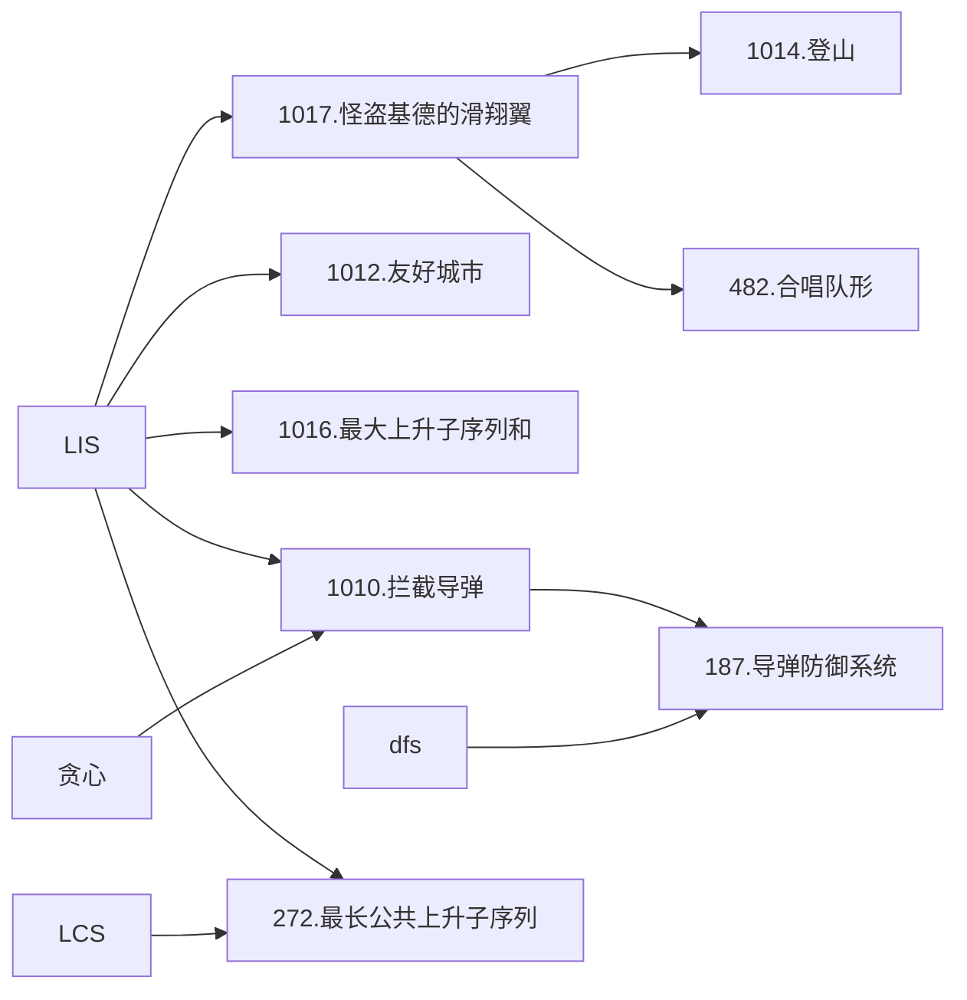

### 最长上升子序列模型（LIS）

---

**本章结构**：

**概念**：由 LIS 可以拓展出许多的题目，关于 LIS，详见 [6.2 线性 DP](https://cuberxl.github.io/Coders-Note/6-动态规划/6.2-线性DP)。

---

**一、怪盗基德的滑翔翼**

- 问题：[Acwing 1017.怪盗基德的滑翔翼](https://www.acwing.com/problem/content/1019/)
- 分析：分别求 $1 \sim i$，$n \sim i$ 的 LIS 即可。

**二、登山**

- 问题：[Acwing 1014.登山](https://www.acwing.com/problem/content/1016/)
- 分析：编号递增 $\Leftrightarrow$ 子序列，一旦开始下降不可上升 $\Leftrightarrow$ 单峰，分别求 $1 \sim i$ 的 LIS $f[i]$，$n \sim i$ 的 LIS $g[i]$，$ans = \max(f[i] + g[i] - 1)$。

**三、合唱队形**

- 问题：[482.合唱队形](https://www.acwing.com/problem/content/484/)
- 分析：分析题目条件，同上题，输出 $n - ans$ 即可。

**四、友好城市**

- 问题：[1012.友好城市](https://www.acwing.com/problem/content/1014/)
- 分析：两条航线相交当且仅当 $i_1 < i_2 \land j_1 > j_2$。
- 可将 $i$ 作为第一关键字排序，求解 $j$ 的 LIS 即可。

**五、最大上升子序列和**

- 问题：[1016.最大上升子序列和](https://www.acwing.com/problem/content/1018/)
- 分析：
	- 状态表示：$f[i]$ 表示以第 $i$ 个数结尾的最长上升子序列和。
	- 状态转移：当 $a[j] < a[i]$ 时，$f[i] = \max(f[i], f[j] + a[i])$。

**六、导弹拦截**

- 问题：[1010.拦截导弹](https://www.acwing.com/problem/content/1012/)
- 分析：
	- 第一问：求最长不上升子序列。
	- 第二问：贪心求解，遍历导弹系统，找第一个能拦截导弹的系统，若没有则新增。
- 优化：由 Dilworth 定理，最长不上升子序列的长度等于最少的不上升子序列覆盖数。

**七、导弹防御系统**

- 问题：[187.导弹防御系统](https://www.acwing.com/problem/content/189/)
- 分析：DFS 维护 $up[i]$ 和 $down[i]$，存储上升/下降的导弹系统，每次扫描找到第一个符合要求的系统，进入下一层递归（DFS 回溯）。
- 注意：数组需单调递减，且数组单调递增。

**八、最长公共上升子序列**

- 问题：[272.最长公共上升子序列](https://www.acwing.com/problem/content/274/)
- 分析：
	- 状态表示：$f[i][j]$ 表示 $a$ 的前 $i$ 个数，$b$ 的前 $j$ 个数，且以 $b[j]$ 结尾的 LCIS 长度。
	- 状态转移：依据 $a[i]$ 分类。
	- $f[i][j] = \begin{cases} f[i-1][j] & a[i] \ne b[j] \\ \max(f[i-1][j], f[i-1][k] + 1) & a[i] = b[j],\ 1 \le k < j,\ b[k] < b[j] \end{cases}$
- 优化：使用 `maxv` 维护 $1 \le k < j$ 且 $b[k] < b[j]$ 时的前缀最大值，将 $O(n^3)$ 降为 $O(n^2)$。

**九：两个合并序列**
- 问题：[1144G.两个合并序列](https://codeforces.com/problemset/problem/1144/G)
- 初步分析：
	- 状态表示：设 $f[i][j]$ 表示前 $\max(i, j)$个数，DS 以 $i$ 结尾， IS 以 $j$ 结尾是否可行。
	- 转移方程：
	设后继 $k=\max(i,j)+1$。
	$$
	f[k][j] = 1\ (if\ i=0 ||a[k]<a[i])\\
	f[i][k] = 1\ (if\ j=0 ||a[k]>a[j])
	$$
	- 空间复杂度 $O(n^2)$，MLE。
- 优化（对偶优化）：
	- 对偶优化：将状态上的某个维度与值域进行对偶交换。
	- 使用对偶优化的条件：当下标状态具有单调性的时候，可以放入值域进行 $\max || \min$。
	- 分析：以 DS 为例，本题中 DS 的结尾元素越大，越容易拼接下一个元素。故我们可以维护结尾元素的最值。
<!--stackedit_data:
eyJoaXN0b3J5IjpbMTAzNDA0OTg0LDEyODQzODM3MDcsLTE5Mz
M4NjE0NzUsLTUzNzE3OTE0MiwxOTU3NDkxNTU2LC0xNzE3NjE0
NDExLC0xOTEzMDI1NzAsLTE1MjA0OTI5MzAsLTE1MzE0MDk3Nj
QsLTk0NTEwOTc3MSwtMTY3NzU5MjY5MiwtMTU4OTg4NTgzNV19

-->