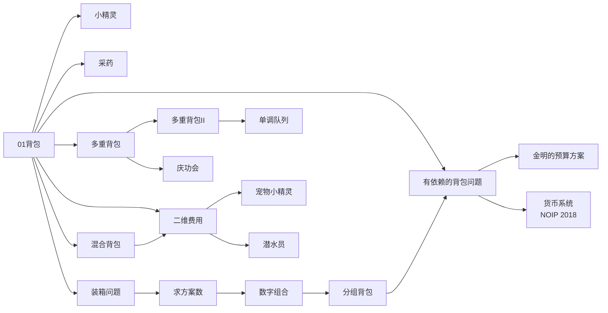

### 背包模型

---
**本章结构**：

**概念**：由背包 DP 可以拓展出许多的题目，关于基础背包问题，详见[6.1 背包 DP](https://cuberxl.github.io/Coders-Note/6-动态规划/6.1-背包DP) 。

**一、采药**
- 问题：[Acwing 423.采药](https://www.acwing.com/problem/content/425/)
- 分析：01背包DP模板题。

**二、装箱问题**
- 问题：[Acwing 1024. 装箱问题](https://www.acwing.com/problem/content/1026/)
- 分析：体积同时也是价值。将01背包的 $w[i]$ 替换为 $v[i]$ 即可。

**三、宠物小精灵之收服**
- 问题：[Acwing 1022. 装箱问题](https://www.acwing.com/problem/content/1024/)
- 分析：本题为二维费用的01背包问题。
	- 花费一：精灵球数量。花费二：皮卡丘体力值。
	- 状态表示：设 $f[i][j][k]$ 为从前 $i$ 个物品中选，且花费 $1$ 不超过 $j$，花费 $2$ 不超过 $k$ 的最大价值。
	- 状态转移（带优化）：
	
	$$f[j][k]=\max(f[j - v_1[i]][k - v_2[i]]+w[i])$$
	- tips：此处皮卡丘体力不可为 $0$，故上限应为 $m_2-1$。
	- 第二问：即为求满足 $f[m_1][k-1]=f[m_1][m_2]$ 的最小k值。

**四、数字组合**
- 问题：[Acwing 278. 数字组合](https://www.acwing.com/problem/content/280/)
- 分析：01 背包模板，不解释。

**五、买书**
- 问题：[Acwing 1023. 买书](https://www.acwing.com/problem/content/1025/)
- 分析：将 4 种货币转换为物品体积，本题即为一道完全背包求方案数量问题。

**六、货币系统**
- 问题：[Acwing 1021. 货币系统](https://www.acwing.com/problem/content/1023/)
- 分析：同上一题，货币面值转换为物品体积，本题即为一道完全背包求方案数量问题。
- tips：本题要开 `long long`。

**七、有依赖的背包问题**
- 问题：[Acwing 10. 有依赖的背包问题](https://www.acwing.com/problem/content/10/)
- 分析：
	- 状态表示：设 $f[u][i]$ 为从以 $u$ 为根的子树取，体积不超过 $j$ 的最大价值。
	- 状态转移：利用树形DP + 分组背包问题的思路。
	- 
<!--stackedit_data:
eyJoaXN0b3J5IjpbLTIyNjgyNDk5MywxNjA0OTQ5MDA2LC03ND
kyMzc2Myw5MTUxMDIwNzQsLTczOTMyNTcwMSwxMTI1MDIwNDFd
fQ==
-->