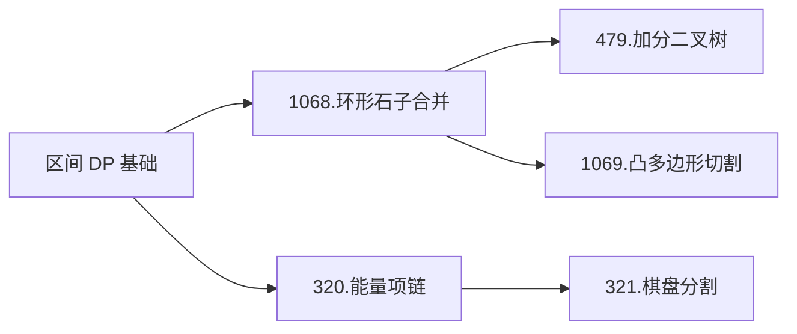

### 区间DP

---
**本章结构**：

**概念**：关于基础区间DP问题，详见[6.3 区间 DP](https://cuberxl.github.io/Coders-Note/6-动态规划/6.1-背包DP) 。

**问题一：环形石子合并**
- 问题：[Acwing 1015. 摘花生](https://www.acwing.com/problem/content/1017/)
- 状态表示：$f[i][j]$ 表示所有从 $(1,1)$走到$(i,j)$的路线。
- 属性：$max$
- 集合划分：依照转移方向来划分。
	- 从上方转移：$f[i][j]=f[i-1][j]+a[i][j]$
	- 从左方转移：$f[i][j]=f[i-1][j]+a[i][j]$

<!--stackedit_data:
eyJoaXN0b3J5IjpbLTE2Nzk2MzA5OTcsMjA0NzQ4NTU1MSwtNT
E4NjMwNjM0XX0=
-->