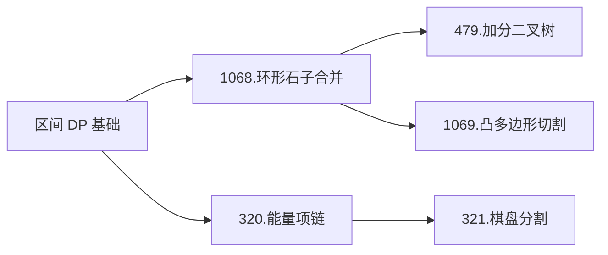

### 区间DP

---
**本章结构**：

**概念**：关于基础区间DP问题，详见[6.3 区间 DP](https://cuberxl.github.io/Coders-Note/6-动态规划/6.1-背包DP) 。

**问题一：环形石子合并**
- 问题：[Acwing 1068.环形石子合并](https://www.acwing.com/problem/content/1070/)
- 分析：考虑转化为朴素石子合并。若枚举在某处断开环，me

<!--stackedit_data:
eyJoaXN0b3J5IjpbLTEwMzUwNTc4NDUsLTE0MTY5NTA4NzQsMj
A0NzQ4NTU1MSwtNTE4NjMwNjM0XX0=
-->