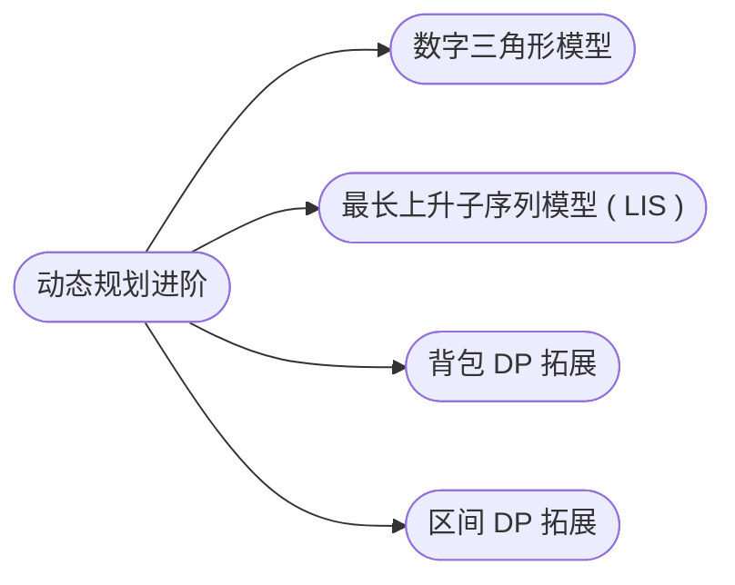

## 动态规划进阶

[**返回上一页**](https://cuberxl.github.io/Coders-Note/)

[**返回首页**](https://cuberxl.github.io/Coders-Note/)

---

#### 动态规划进阶

> DP 模型的深入应用与扩展

| 编号 | 简介 |
| :--- | :--- |
| 6\*.1 | 数字三角形模型 |
| 6\*.2 | 最长上升子序列模型 ( LIS ) |
| 6\*.3 | 背包模型 |
| 6\*.4 | 区间 DP 模型 |

---

#### 章节结构

---

#### 跳转链接

- [6\*.1 数字三角形模型](https://cuberxl.github.io/Coders-Note/6*-动态规划进阶/6*.1-数字三角形模型)
- [6\*.2 最长上升子序列模型 ( LIS )](https://cuberxl.github.io/Coders-Note/6*-动态规划进阶/6*.2-最长上升子序列模型（LIS）)
- [6\*.3 背包 DP 拓展](https://cuberxl.github.io/Coders-Note/6*-动态规划进阶/6*.3-背包DP拓展)
- [6\*.4 区间 DP 拓展](https://cuberxl.github.io/Coders-Note/6*-动态规划进阶/6*.4-区间DP拓展)
