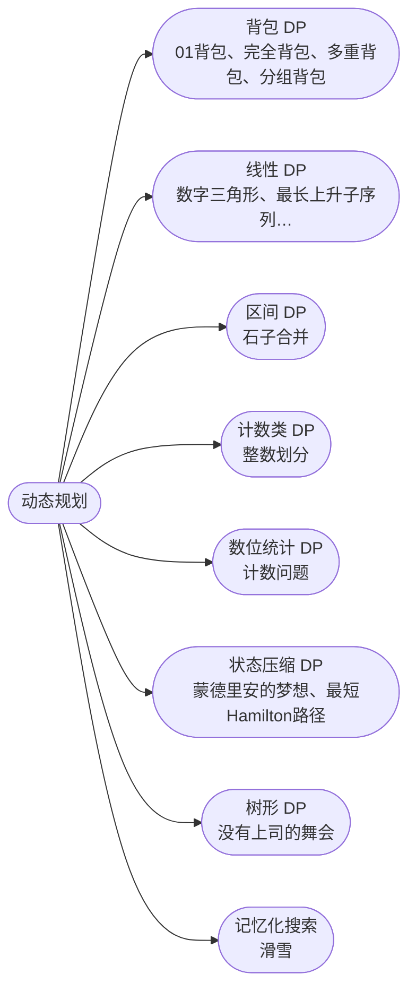

## 动态规划

[**返回上一页**](https://cuberxl.github.io/Coders-Note/)

[**返回首页**](https://cuberxl.github.io/Coders-Note/)

---

#### 动态规划

> DP 专题

| 编号 | 简介 |
| :--- | :--- |
| 6B.1 | 01背包、完全背包、多重背包、分组背包 |
| 6B.2 | 数字三角形、最长上升子序列、最长公共子序列、最短编辑距离 |
| 6B.3 | 石子合并 |
| 6B.4 | 整数划分 |
| 6B.5 | 计数问题 |
| 6B.6 | 蒙德里安的梦想、最短Hamilton路径 |
| 6B.7 | 没有上司的舞会 |
| 6B.8 | 滑雪 |

---

#### 章节结构

---

#### 跳转链接

- [6B.1 背包 DP](https://cuberxl.github.io/Coders-Note/6B-动态规划/6.1-背包DP)
- [6B.2 线性 DP](https://cuberxl.github.io/Coders-Note/6B-动态规划/6.2-线性DP)
- [6B.3 区间 DP](https://cuberxl.github.io/Coders-Note/6B-动态规划/6.3-区间DP)
- [6B.4 计数类 DP](https://cuberxl.github.io/Coders-Note/6B-动态规划/6.4-计数类DP)
- [6B.5 数位统计 DP](https://cuberxl.github.io/Coders-Note/6B-动态规划/6.5-数位统计DP)
- [6B.6 状态压缩 DP](https://cuberxl.github.io/Coders-Note/6B-动态规划/6.6-状态压缩DP)
- [6B.7 树形 DP](https://cuberxl.github.io/Coders-Note/6B-动态规划/6.7-树形DP)
- [6B.8 记忆化搜索](https://cuberxl.github.io/Coders-Note/6B-动态规划/6.8-记忆化搜索)
