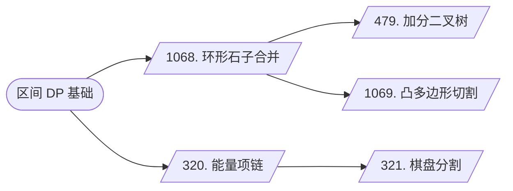

## 区间DP拓展

[**返回上一页**](https://cuberxl.github.io/Coders-Note/6P-动态规划进阶/)

[**返回首页**](https://cuberxl.github.io/Coders-Note/)

---

#### 前置知识

- [区间DP](https://cuberxl.github.io/Coders-Note/6B-动态规划/6.3-区间DP) —— 本页都是它的变形题。

---

#### 区间DP

**本章结构**：

**概念**：关于基础区间 DP 问题，详见 [6.3 区间 DP](https://cuberxl.github.io/Coders-Note/6B-动态规划/6.3-区间DP)。

---

#### 环形石子合并

**问题**：[Acwing 1068. 环形石子合并](https://www.acwing.com/problem/content/1070/)

**分析**：考虑转化为朴素石子合并。

- 若在某处断开环，枚举缺口，时间复杂度为 $O(n^4)$，TLE。
- 考虑将链复制一倍，在其上进行区间 DP，统计答案时枚举长度为 $n$ 的区间。
