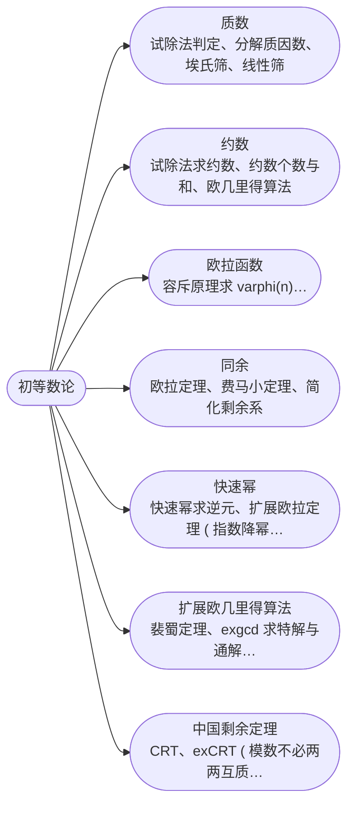

## 初等数论

[**返回上一页**](https://cuberxl.github.io/Coders-Note/8B-数学/)

[**返回首页**](https://cuberxl.github.io/Coders-Note/)

---

#### 初等数论

> 数论基础与常用算法

| 编号 | 简介 |
| :--- | :--- |
| 8B.1.1 | 试除法判定、分解质因数、埃氏筛、线性筛 |
| 8B.1.2 | 试除法求约数、约数个数与和、欧几里得算法 |
| 8B.1.3 | 容斥原理求 $\varphi(n)$、筛法求欧拉函数 |
| 8B.1.4 | 欧拉定理、费马小定理、简化剩余系 |
| 8B.1.5 | 快速幂求逆元、扩展欧拉定理 ( 指数降幂 ) |
| 8B.1.6 | 裴蜀定理、exgcd 求特解与通解、线性同余方程 |
| 8B.1.7 | CRT、exCRT ( 模数不必两两互质 ) |

---

#### 章节结构

---

#### 跳转链接

- [8B.1.1 质数](https://cuberxl.github.io/Coders-Note/8B-数学/8.1-初等数论/8.1.1-质数)
- [8B.1.2 约数](https://cuberxl.github.io/Coders-Note/8B-数学/8.1-初等数论/8.1.2-约数)
- [8B.1.3 欧拉函数](https://cuberxl.github.io/Coders-Note/8B-数学/8.1-初等数论/8.1.3-欧拉函数)
- [8B.1.4 同余](https://cuberxl.github.io/Coders-Note/8B-数学/8.1-初等数论/8.1.4-同余)
- [8B.1.5 快速幂](https://cuberxl.github.io/Coders-Note/8B-数学/8.1-初等数论/8.1.5-快速幂)
- [8B.1.6 扩展欧几里得算法](https://cuberxl.github.io/Coders-Note/8B-数学/8.1-初等数论/8.1.6-扩展欧几里得算法)
- [8B.1.7 中国剩余定理](https://cuberxl.github.io/Coders-Note/8B-数学/8.1-初等数论/8.1.7-中国剩余定理)
