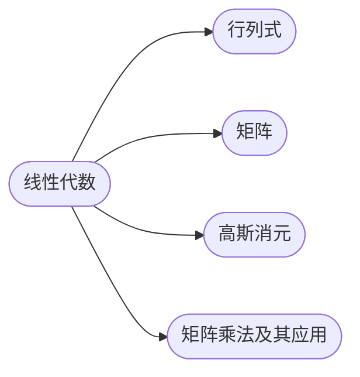

## 线性代数

[**返回上一页**](https://cuberxl.github.io/Coders-Note/8B-数学/)

[**返回首页**](https://cuberxl.github.io/Coders-Note/)

---

#### 线性代数

> 矩阵与方程组

| 编号 | 简介 |
| :--- | :--- |
| 8B.2.1 | 行列式的定义与性质 |
| 8B.2.2 | 矩阵的概念、运算与特殊矩阵 |
| 8B.2.3 | 增广矩阵、初等行变换、高斯消元 |
| 8B.2.4 | 矩阵乘法、矩阵快速幂 |

---

#### 章节结构

---

#### 跳转链接

- [8B.2.1 行列式](https://cuberxl.github.io/Coders-Note/8B-数学/8B.2-线性代数/8B.2.1-行列式)
- [8B.2.2 矩阵](https://cuberxl.github.io/Coders-Note/8B-数学/8B.2-线性代数/8B.2.2-矩阵)
- [8B.2.3 高斯消元](https://cuberxl.github.io/Coders-Note/8B-数学/8B.2-线性代数/8B.2.3-高斯消元)
- [8B.2.4 矩阵乘法及其应用](https://cuberxl.github.io/Coders-Note/8B-数学/8B.2-线性代数/8B.2.4-矩阵乘法及其应用)
