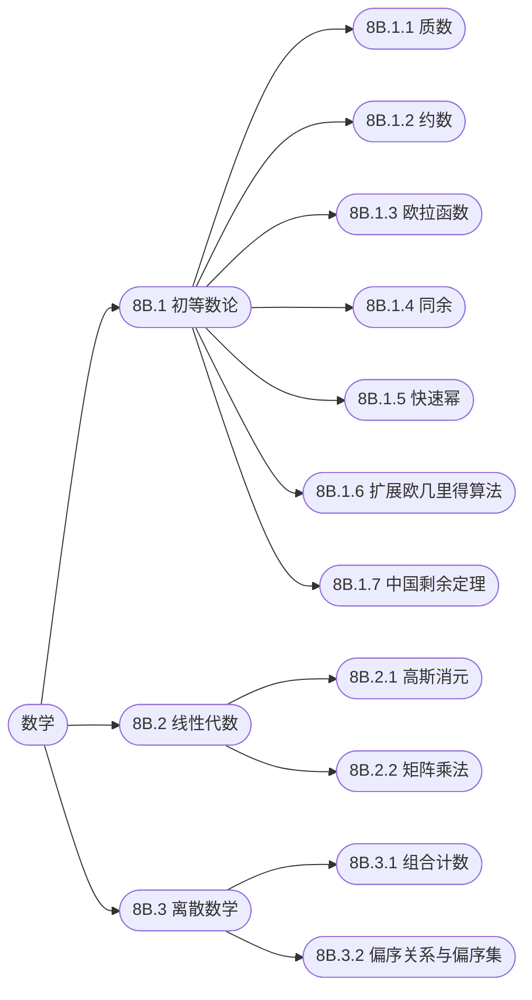

## 数学

[**返回上一页**](https://cuberxl.github.io/Coders-Note/)

[**返回首页**](https://cuberxl.github.io/Coders-Note/)

---

#### 数学

> 数论、线性代数与离散数学

| 编号 | 简介 |
| :--- | :--- |
| 8B.1 | 质数、约数、欧拉函数、同余、快速幂、扩展欧几里得、中国剩余定理 |
| 8B.2 | 高斯消元、矩阵乘法 |
| 8B.3 | 组合计数、偏序关系与偏序集 |

---

#### 章节结构

---

#### 跳转链接

- [8B.1 初等数论](https://cuberxl.github.io/Coders-Note/8B-数学/8B.1-初等数论/)
- [8B.2 线性代数](https://cuberxl.github.io/Coders-Note/8B-数学/8B.2-线性代数/)
- [8B.3 离散数学](https://cuberxl.github.io/Coders-Note/8B-数学/8B.3-离散数学/)
