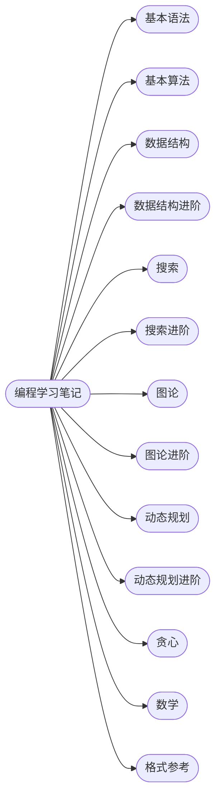

## 编程学习笔记

---

#### 编程学习笔记

本笔记库基于 C++ 语言构建，旨在系统性地梳理算法竞赛与数据结构领域的核心知识体系。

笔者通过模块化的分类进行结构化存储，便于知识检索与体系化复盘。

您可以通过以下总目录索引，快速跳转至对应的章节页面进行查阅。

---

#### 笔记目录

| 编号 | 简介 |
| :--- | :--- |
| 0 | 写笔记时用到的排版语法速查 |
| 1 | C++ 语法基础与常用容器 |
| 2 | 基础算法思想与模板 |
| 3 | 常用数据结构实现与应用 |
| 3\* | 基础数据结构的扩展与高级应用 |
| 4 | DFS 与 BFS |
| 4\* | 搜索算法的扩展应用 |
| 5 | 图的基础与最短路算法 |
| 5\* | 最短路算法的深入应用与扩展 |
| 6 | DP 专题 |
| 6\* | DP 模型的深入应用与扩展 |
| 7 | 贪心算法思想 |
| 8 | 数论、线性代数与离散数学 |

---

#### 章节结构

---

#### 跳转链接

- [0 格式参考](https://cuberxl.github.io/Coders-Note/0-格式/)
- [1 基本语法](https://cuberxl.github.io/Coders-Note/1-基本语法/)
- [2 基本算法](https://cuberxl.github.io/Coders-Note/2-基本算法/)
- [3 数据结构](https://cuberxl.github.io/Coders-Note/3-数据结构/)
- [3\* 数据结构进阶](https://cuberxl.github.io/Coders-Note/3*-数据结构进阶/)
- [4 搜索](https://cuberxl.github.io/Coders-Note/4-搜索/)
- [4\* 搜索进阶](https://cuberxl.github.io/Coders-Note/4*-搜索进阶/)
- [5 图论](https://cuberxl.github.io/Coders-Note/5-图论/)
- [5\* 图论进阶](https://cuberxl.github.io/Coders-Note/5*-图论进阶/)
- [6 动态规划](https://cuberxl.github.io/Coders-Note/6-动态规划/)
- [6\* 动态规划进阶](https://cuberxl.github.io/Coders-Note/6*-动态规划进阶/)
- [7 贪心](https://cuberxl.github.io/Coders-Note/7-贪心/)
- [8 数学](https://cuberxl.github.io/Coders-Note/8-数学/)

---

#### 作者：cuberxl

> 笔者知识储备有限，疏漏与不足之处敬请指正。
>
> *参考资料：Acwing 算法基础课 / 《算法竞赛进阶指南》 / OI Wiki*
